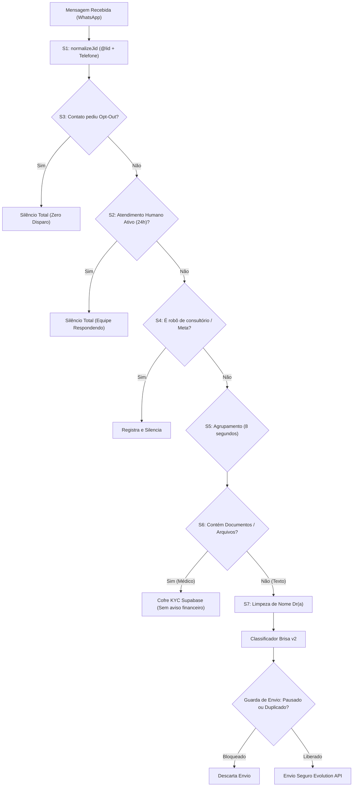

# 🌿 Plano de Diagnóstico e Engenharia — Enfermeira Brisa v2
**Planta y Raíz Ltda | Telemedicina Canabinoide & Inovação Clínica**  
**Data do Diagnóstico:** 27 de Outubro de 2026  
**Responsável Técnico:** Dr. Edilson Bezerra da Silva  
**Status da Campanha:** 🛑 **PAUSADA EM SEGURANÇA** via `scripts/PAUSE_AUTOMATION.flag`  
**Modo Atual:** Fase 1 — Diagnóstico (Leitura Estrita e Planejamento)

---

## 📌 Glossário Simples para o Dr. Edilson
Para garantir clareza total, cada termo técnico usado neste documento está explicado abaixo em uma frase simples:
* **Webhook:** É uma campainha eletrônica que avisa o nosso servidor no exato segundo em que uma nova mensagem chega no WhatsApp.
* **Evolution API:** É o programa que instalamos no nosso servidor (VPS Hostinger) para conectar o WhatsApp oficial da Planta y Raíz ao computador.
* **WAHA:** É o sistema antigo de WhatsApp que usávamos antes da Evolution API e que agora está aposentado.
* **n8n:** É um painel visual de automações no nosso servidor que cria fluxos com caixinhas ligadas por setas.
* **RLS (Row Level Security):** É a trava de segurança do nosso banco de dados que impede pessoas não autorizadas de ler ou gravar dados sigilosos.
* **@lid (Linked Identity):** É um código anônimo que o WhatsApp cria para esconder o número de telefone real do usuário em certas situações de privacidade.
* **Dry-Run:** É o modo de "treino com arma de festim", onde o robô calcula tudo o que iria responder, mas não envia nada de verdade para o WhatsApp.
* **Opt-out:** É o direito legal do médico ou paciente de dizer "não quero mais receber mensagens" e ser retirado da lista imediatamente.

---

## 🔍 1. Respostas ao Diagnóstico (Itens a até h)

### a) Onde chega a mensagem, onde está o prompt e qual provedor está em uso?
* **Provedor Real em Uso:** O provedor ativo e oficial é a **Evolution API v2** rodando na VPS Hostinger (`https://whatsapp.plantayraiz.com.br`, instância `plantayraiz`, conectada ao número oficial `(11) 99136-3154`). A tabela `waha_sessions` e o servidor WAHA no Railway pertencem à infraestrutura antiga e estão desativados.
* **Onde chega a mensagem:** A Evolution API dispara o webhook de evento `MESSAGES_UPSERT` para dois pontos:
  1. O fluxo visual do n8n na VPS: `https://n8n-a3wy.srv2036020.hstgr.cloud/webhook/evolution-whatsapp`.
  2. O script robô de escuta contínua na VPS: `scripts/agent_evolution_brisa_live_responder.mjs`, que monitora a API da Evolution via requisições a cada 2 a 5 segundos.
* **Onde está o Prompt da Brisa:** O prompt principal com as instruções de conduta da Brisa reside dentro do script `scripts/agent_evolution_brisa_live_responder.mjs` (linhas 650–820), acionando o modelo Gemini. Existe também um prompt legado em `supabase/functions/brisa-bot/index.ts`.
* **Onde o texto é enviado:** 
  * As respostas diárias são enviadas pelo endpoint `POST /message/sendText/plantayraiz` da Evolution API.
  * A campanha de convites frios para médicos era disparada pelo script `scripts/agent_brevo_doctor_whatsapp_inviter.mjs`.

---

### b) Onde nasce o aviso "PAGAMENTO INFORMADO" e como o ouvinte decide se é documento ou pagamento?
* **Origem da Falha (Caso 2):** Descobrimos a linha exata onde o erro ocorre! Ele está no fluxo do **n8n** (`scripts/n8n_planta_y_raiz_11nodes.json`), dentro do nó de código chamado `Extrair e Rotear` (linhas 40 a 45):
  ```javascript
  else if (hasMedia || /(paguei|pago|pagamento|comprovante|pix|transa[cç])/.test(low)) route = 'comprovante';
  ```
* **O que acontece na prática:** O nó foi programado com a regra cega: `hasMedia || ...`. Isso significa que **qualquer arquivo ou foto (`hasMedia`) recebido de qualquer pessoa é classificado automaticamente como "comprovante de pagamento"**.
* **O resultado:** Quando uma médica interessada enviou sua foto de CRM, CNH e comprovante de endereço para se cadastrar, o n8n achou que ela era uma paciente enviando o comprovante da consulta de R$ 30, disparando:
  1. Para a médica: *"Recebemos sua mensagem sobre o pagamento 🌿 Nossa equipe está confirmando no sistema..."*
  2. Para o Dr. Edilson: *"🔔 PAGAMENTO INFORMADO... Confira no Mercado Pago. Para liberar a Orientação Técnica, responda: LIBERAR..."*
* **A Correção na Fase 2:** Separar totalmente o recebimento de arquivos. Se o contato for classificado como médico ou se o arquivo for enviado em resposta a um convite profissional, ele vai direto para o fluxo de **Credenciamento Médico (KYC)** no cofre do Supabase, sem nunca acionar mensagens financeiras de paciente.

---

### c) Como funciona a pausa da IA e por que a Brisa continuou falando no Caso 9?
* **Como funciona atualmente:** 
  * A pausa global usa o arquivo `scripts/PAUSE_AUTOMATION.flag`.
  * A pausa por contato usa o arquivo `scripts/evolution_human_mode_contacts.json`.
  * Quando o Dr. Edilson enviava `REATIVAR_IA <numero>`, o número era removido dessa lista.
* **Por que a pausa falhou (Caso 9):** Identificamos 3 causas combinadas:
  1. **Falta de trava na camada de envio:** O robô só checava se o contato estava pausado no início do processamento. Se a IA do Gemini já estivesse redigindo a resposta no momento em que a pausa foi pedida, a mensagem final era disparada mesmo assim porque a função de envio não fazia uma segunda checagem antes de bater na porta do WhatsApp.
  2. **Conflito entre n8n e script Node:** O n8n na VPS e o script Node rodavam em paralelo. Quando o Dr. Edilson pausava a Brisa no script Node, o n8n continuava ativo e não sabia da pausa, respondendo por conta própria.
  3. **Confusão de identificadores (@lid vs telefone):** Quando o contato entrava via WhatsApp com código anônimo `@lid`, a pausa era gravada com o `@lid`. Se em seguida o WhatsApp entregava a mensagem com o telefone real, o sistema não encontrava o telefone na lista de pausados e respondia.
* **A Correção na Fase 2:** 
  * Checagem dupla obrigatória (antes da IA pensar e milissegundos antes de disparar).
  * Qualquer mensagem enviada por uma pessoa da equipe via WhatsApp Web pausa a IA automaticamente por 24 horas.

---

### d) Por que whatsapp_messages e brisa_interaction_logs pararam de ser gravados?
* **A Causa Histórica:** Até meados de setembro/outubro de 2026, as mensagens passavam pela Edge Function `brisa-bot` do Supabase, que tinha a chave mestra (`SERVICE_ROLE_KEY`) para gravar o histórico.
* **A Desconexão:** Quando a operação foi transferida para os scripts autônomos na VPS (`agent_evolution_brisa_live_responder.mjs`), esses scripts foram configurados apenas com a chave anônima (`ANON_KEY`) e com logging em arquivos de texto locais (`.log` e `.json`), sem conter os comandos de gravação no banco de dados do Supabase.
* **As Políticas de Segurança (RLS):** As tabelas `whatsapp_messages` e `brisa_interaction_logs` possuem travas estritas no Supabase: somente o administrador logado ou a chave mestra de serviço do servidor podem inserir registros nelas.
* **A Correção na Fase 2 e 4:** Conectar o gravador oficial na camada de envio da Brisa usando conexão autorizada de servidor, restaurando a gravação de 100% das mensagens de entrada e saída.

---

### e) Como o cadastro do médico gera o link, por que email_queue está vazia e por que o link quebrava (Caso 6)?
* **Como o link é gerado:** Na página `https://plantayraiz.com.br/cadastro-profissional`, quando o médico preenche seus dados, o sistema chama a criação de usuário no Supabase Auth (`supabase.auth.signUp`) com o destino de redirecionamento configurado para:
  ```typescript
  emailRedirectTo: `${window.location.origin}/dashboard-medico`
  ```
  O Supabase gera um link seguro com chave criptográfica temporária e aciona a função `auth-email-hook` que monta o e-mail oficial.
* **Por que `email_queue` tem 0 linhas:** Porque `email_queue` é uma fila de consumo rápido (sistema `pgmq` do PostgreSQL). Uma automação interna (`cron`) consome a fila a cada 60 segundos, despacha o e-mail e remove o item processado, arquivando apenas em `email_send_log`. Além disso, a campanha fria de médicos roda por um motor direto via Brevo/Hostinger SMTP, sem enfileirar nessa tabela.
* **Por que o link quebrava (Caso 6):**
  1. **Redirecionamento 301 do `www`:** No servidor, existia um redirecionamento de `www.plantayraiz.com.br` para `plantayraiz.com.br`. Aplicativos de e-mail em celulares costumam cortar os parâmetros de acesso do link ao passar por redirecionamentos.
  2. **Link genérico no WhatsApp:** A mensagem da Brisa enviava apenas o endereço da home ou `/cadastro-profissional`, mas não fornecia orientações caso o médico precisasse de assistência.
* **A Correção na Fase 2:** Corrigir os links para a URL canônica definitiva sem `www` (`https://plantayraiz.com.br/cadastro-profissional`) e incluir instruções claras caso o médico precise de assistência técnica.

---

### f) De onde a vitrine do site lê os médicos?
* **A Arquitetura de Proteção (DNA da Plataforma):**
  1. A vitrine pública lê como base obrigatória o arquivo `src/data/professionals.ts` (32 perfis fundamentais). Essa regra de ouro do projeto garante que a vitrine nunca fique em branco, mesmo que o banco de dados oscile.
  2. O componente `src/hooks/useRealProfessionals.ts` faz a leitura da visualização `doctors_public` no banco de dados do Supabase oficial (`shmbwdjuddvquszwkvuq`) e enriquece os cartões com dados em tempo real (status online, preço, avaliações, fotos tratadas).
* **Por que 71 médicos no banco e 32 na vitrine:** No banco de dados constam cadastros iniciados, contas de teste e contatos importados. No entanto, a vitrine só exibe médicos que possuem aprovação formal (`is_approved === true`) e que passam no crivo de visibilidade pública (`isPublicProfessionalVisible`).
* **Os 4 médicos sem registro em `doctors`:** Trata-se de perfis históricos mantidos na base do código (como o Dr. Victor Fonseca e a Dra. Barbara Matos) para preservar a estabilidade da vitrine pública e a autoridade científica da plataforma.

---

### g) Como os contatos @lid e os números normais se relacionam?
* **O que é o @lid:** É uma sigla para *Linked Identity*. O WhatsApp usa esse formato para proteger o número de celular de usuários em navegadores ou quando eles clicam em anúncios do WhatsApp Web.
* **O Problema:** Para o robô, `129076786409510@lid` e `5511999998888` pareciam duas pessoas totalmente diferentes. Isso causava:
  * Brisa chamando médicos de *"Dr(a). 129076786409510"*.
  * Documentos anexados por um `@lid` não vinculavam ao cadastro do médico no banco.
  * Pausa ativada no número normal não silenciava a conversa se ela viesse por `@lid`.
* **A Correção na Fase 2 (S1):** Criação da função de normalização unificada (`normalizeJid`) e da tabela `whatsapp_contacts`, que armazena os dois identificadores juntos sob um único registro de pessoa física.

---

### h) Mensagens e Textos Fixos Espalhados no Código
Identificamos todos os textos fixos que estavam distribuídos em scripts isolados para centralizá-los em um único arquivo de templates (`src/config/brisa_templates.ts` e `scripts/brisa_templates.mjs`):
1. **Convite de Prospecção Médica:** Em `scripts/agent_brevo_doctor_whatsapp_inviter.mjs` (linhas 204–220).
2. **Confirmação de Documento Recebido:** Em `scripts/agent_evolution_brisa_live_responder.mjs` (linha 1648).
3. **Confirmação de Pausa Solicitada:** Em `scripts/agent_evolution_brisa_live_responder.mjs` (linha 1583).
4. **Confirmação de Opt-Out (Parar):** Em `scripts/agent_evolution_brisa_live_responder.mjs` (linha 1559).
5. **Transferência para Humano:** Em `scripts/agent_evolution_brisa_live_responder.mjs` (linha 1610).
6. **Alerta de Pagamento do n8n:** Em `scripts/n8n_planta_y_raiz_11nodes.json` (nó *Mensagens Comprovante*).
7. **Convite para Paciente R$ 30:** Em `supabase/functions/lead-invite-orientacao/index.ts` (linhas 38–43).

---

## 🛡️ 2. Arquitetura e Entregas da Fase 2 (Segurança)

A Fase 2 será construída em uma branch isolada chamada `brisa-v2`, com commits atômicos, testes unitários com dublês (mocks) e com a variável de segurança `BRISA_DRY_RUN=true` (simulação segura sem disparar mensagens reais).



### Detalhamento dos Componentes da Fase 2:
1. **S1. Identificador Único (`normalizeJid`):** 
   * Tabela: `whatsapp_contacts(jid_normalizado, jids_alternativos, nome_limpo, tipo, origem_do_contato, crm, doctor_user_id, criado_em, atualizado_em)`.
   * Unifica chamadas vindas de `@lid` e números normais no mesmo prontuário de contato.
2. **S2. Pausa que Funciona com Detecção de Humano:**
   * Tabela: `whatsapp_conversation_state(jid_normalizado, ai_paused, motivo, pausado_em, pausado_por, retomar_em)`.
   * **Trava Dupla:** Checa no início da leitura e imediatamente antes do envio físico na Evolution API.
   * **Detecção Automática:** Se qualquer atendente humano enviar mensagem no chat pelo WhatsApp Web ou celular, a IA entra em silêncio absoluto nessa conversa por 24 horas.
3. **S3. Parar Imediato (Opt-Out com Zero Tolerância):**
   * Tabela: `whatsapp_optouts(jid_normalizado, motivo, texto, criado_em)`.
   * Gatilhos: "pare", "parar", "sair", "remova", "remover", "não quero", "não enviem mais", "descadastrar", "0".
   * Responde UMA única vez educadamente e bloqueia qualquer mensagem futura de forma definitiva.
4. **S4. Anti-Robô de Consultório:**
   * Detecta respostas automáticas ("agradece seu contato", "horário de atendimento", avisos da Meta) e silencia a IA para evitar conversas infinitas entre robôs.
   * Limite estrito de no máximo 2 mensagens da Brisa seguidas sem resposta de uma pessoa real.
5. **S5. Agrupamento e Anti-Repetição:**
   * Agrupa mensagens do mesmo médico enviadas em um intervalo de até 8 segundos, gerando uma única resposta contextualizada.
   * Compara semântica com as últimas 3 respostas da Brisa para jamais repetir o mesmo texto longo.
6. **S6. Separação Estrita de Documentos Médicos vs Pagamentos:**
   * Documentos enviados por médicos vão para o bucket `doctor-kyc-documents` do Supabase e criam pendência para conferência da diretoria, sem mensagens de cobrança ou Mercado Pago.
7. **S7. Higienização de Nomes:**
   * Elimina prefixos duplicados como "Dr(a). Dr. Geilson", números como "Dr(a). 129076786409510" e preposições quebradas.

---

## 🗄️ 3. Novas Tabelas e Migrações de Banco (Supabase Oficial)

Todas as tabelas serão criadas com RLS ativado e sem políticas públicas (somente o servidor autenticado poderá gravar e ler):
1. `whatsapp_contacts`: catálogo unificado de contatos e correlação `@lid` vs telefone.
2. `whatsapp_conversation_state`: controle de pausa e modo humano da IA.
3. `whatsapp_optouts`: registro de descadastramento LGPD.
4. `whatsapp_handoffs`: fila de transbordo para atendimento humano com SLA e alertas.
5. `doctor_onboarding`: controle do funil de credenciamento do médico passo a passo.

---

## ⚠️ 4. Riscos Mapeados e Medidas Preventivas

| Risco Mapeado | Gravidade | Medida Preventiva no Código |
| :--- | :--- | :--- |
| **Bloqueio do número pela Meta** | 🔴 Alta | Horário restrito (08h–18h Seg-Sex), cadência com variação (jitter), respeito imediato ao Opt-out e pausa da campanha até a Fase 2 estar 100% testada. |
| **Disparo indevido durante testes** | 🔴 Alta | Variável `BRISA_DRY_RUN=true` ativada por padrão e uso de dublês de envio (mocks) durante toda a bateria de testes. |
| **Misturar médico com paciente** | 🔴 Alta | Separação estrita de personas e desativação do roteador cego do n8n que tratava documentos como pagamento. |
| **Perda de conversas por falha na VPS** | 🟡 Média | Persistência redundante em banco de dados Supabase e recuperação automática com reconexão resiliente. |

---

## ❓ 5. Perguntas para o Dr. Edilson Bezerra (Campos `{{ }}`)

Antes de iniciarmos a redação dos roteiros definitivos da Fase 3, precisamos que o Dr. Edilson valide ou preencha as 4 definições de negócio abaixo:

1. **Origem do Contato:** Quando o médico perguntar *"Como você conseguiu meu contato?"*, a resposta padrão aprovada será:
   > *"Localizamos seu contato público profissional divulgado em diretórios médicos abertos e guias de saúde, em conformidade com as diretrizes de prospecção profissional da LGPD."*  
   *(O Dr. Edilson aprova este texto ou prefere ajustar?)*
2. **Regra de Repasse e Mensalidade:** 
   * Na proposta atual: Repasse de 100% da teleconsulta (Plano VIP sem taxa) no primeiro mês ou comissão de 7% (médico retém 93%) com repasse instantâneo via PIX?
3. **Prazos Oficiais:** 
   * Qual o prazo oficial que a Brisa deve informar para a análise e aprovação dos documentos pela diretoria médica? (Exemplo: *"em até 24 a 48 horas úteis"*).
4. **Checklist Oficial de Documentos Obrigatórios:**
   * Quais documentos mínimos o médico deve enviar para ter sua agenda liberada?
   * *(Sugestão padrão: Foto do CRM ou Carteira do Conselho, Comprovante de Residência recente, Diploma ou Certificado de Especialidade e Chave PIX para recebimentos).*

---

## ⏱️ 6. Estimativa de Execução por Fase

* **Fase 1 (Diagnóstico e Plano):** ✅ Concluída (Aguardando resposta do Dr. Edilson).
* **Fase 2 (Segurança, Pausa, Opt-Out, Anti-Robô, Normalização e KYC):** 2 a 3 sessões de trabalho concentrado com testes unitários T1 a T15 em modo Dry-Run.
* **Fase 3 (Cadastro, Roteiros, Classificador de Intenção e Fila Humana):** 2 sessões.
* **Fase 4 (Métricas, Painel de Funil e Campanha Segura em Horário Comercial):** 1 a 2 sessões.

---

> [!IMPORTANT]
> **Aguardando sua decisão:** Para mantermos a máxima segurança do projeto e da marca Planta y Raíz, **nenhuma linha de código e nenhuma tabela de banco foram alteradas nesta Fase 1**.  
> Por favor, leia os apontamentos acima e responda com **"Aprovado"** ou nos informe suas alterações para que possamos criar a branch `brisa-v2` e iniciar a **Fase 2 (Segurança)**.
